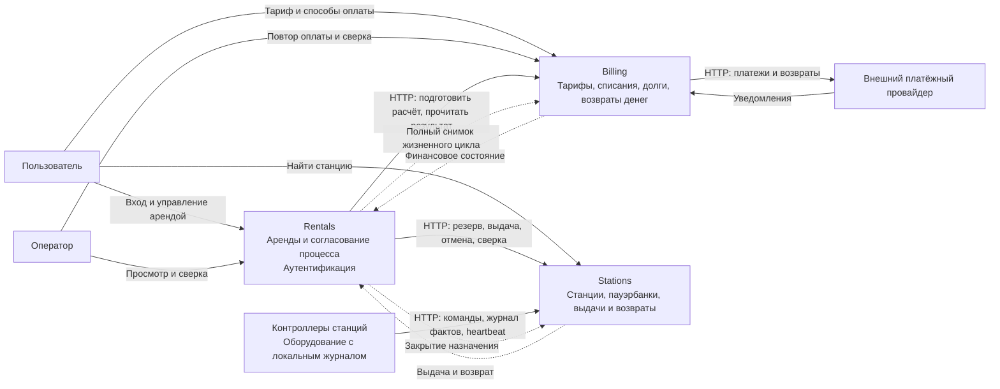

# 0. Продукт
Для проекта выбран существующий продукт - "Бери заряд". 

# 1. Карта контекстов

## Назначение

Пользователь арендует повербанк, оплачивая каждый период банковской картой. Возвращает устройство в любую подходящую станцию сети. Финансовый результат и физическое завершение аренды — разные факты: возврат принимается и при недоступности сервиса оплаты.
Есть три сервиса: 
- сервис Rentals: отвечает за аренду повербанка
- сервис Billing: сервис оплаты
- сервис Stations: для управления станциями

Сплошные связи — синхронные HTTP-запросы; пунктирные связи между сервисами — события через Kafka. У сервисов нет доступа к чужим таблицам. Внешние протоколы оборудования и провайдера переводятся адаптерами во внутренние модели.

## Rentals

Владеет `rentals`, состояниями процесса, фактами начала/конца пользования, ключами идемпотентности, журналом шагов, inbox/outbox. Хранит ссылку на пауэрбанк, станции выдачи/возврата и снимок тарифа, полученный от Billing; не вычисляет денежный долг по собственным таблицам. Оркестрирует резервирование, оплату и выдачу, восстанавливает неизвестный результат по прежним идентификаторам. Отдельность нужна для независимого жизненного цикла аренды: при отказе финансового сервиса и его БД Rentals завершает аренду по достоверному возврату, сохраняя событие для последующего расчёта. Его worker и HTTP API относятся к одному сервису.

## Billing

Владеет `tariff_versions`, токенизированными способами оплаты, `rental_billings`, `period_charges`, `payment_attempts`, `refunds`, журналом финансовых изменений, inbox/outbox. Денежного кошелька нет; `debt_minor` — сумма неоплаченных обязательств, а не доступный баланс. Проводит первый платёж, самостоятельно планирует следующие периоды, проверяет результаты у провайдера и возвращает ошибочно списанные периоды. Отдельность обоснована независимым исполнением денежных обязательств: уже созданные платежи и возвраты восстанавливаются при остановке Rentals, а неисправность Billing не блокирует приём устройств. Платёжный провайдер — интеграция этого контекста, не четвёртый сервис.

## Stations

Владеет `stations`, `slots`, `powerbanks`, назначениями устройств арендам, резервами, операциями выдачи, очередью команд, первичными фактами контроллеров, подтверждёнными возвратами и outbox/inbox. Проверяет доступность устройства атомарно, выдаёт команду с устойчивым ключом и сохраняет доказательство её результата. На принимающей станции контроллер может не знать аренду: Stations связывает считываемый `powerbank_id` с сохранённым назначением. Контекст отделён из-за протокола оборудования, долгих разрывов связи и необходимости отличать отправленную команду от физического действия. Контроллеры — внешнее оборудование с собственным локальным журналом, не общая БД облачных сервисов.

## Владение данными и инварианты

| ID | Правило | Кто обеспечивает |
| --- | --- | --- |
| I1 | Одно устройство не зарезервировано и не выдано двум незавершённым назначениям | Stations: локальная транзакция и уникальное активное назначение `powerbank_id` |
| I2 | У пользователя не более одной незавершённой аренды | Rentals: уникальность по `user_id`, пока состояние не `RETURNED`/`CANCELLED` |
| I3 | Нет выдачи без успешной оплаты первого периода | Rentals проверяет Billing; Stations принимает команду только от доверенного Rentals с `initial_payment_id` |
| I4 | У периода не более одного успешного списания | Billing: уникальное `(rental_id, period_index)`; новая попытка только после подтверждённого отказа предыдущей |
| I5 | Сумма возврата не больше успешной оплаты, один возврат на начисление | Billing: уникальный `charge_id` у возврата, стабильный ключ операции провайдера |
| I6 | `RETURNED` означает сохранённый факт физического возврата | Rentals: `return_id`, `returned_at`; обновление и outbox в одной транзакции без обращения к Billing |
| I7 | Деньги за невыдачу возвращаются только после запрета поздней выдачи | Stations: `safe_to_refund` и `non_dispense_proof_id`; Rentals передаёт доказанное основание Billing |
| I8 | При повторной доставке физический или финансовый эффект не повторяется | Участники: бизнес-ключи, inbox, устойчивые журналы; контроллер дедуплицирует команды |

I1–I5 и I8 — локальные ограничения и обязанности участников. I3 — доверенный протокол, а не общая SQL-транзакция: получение `initial_payment_id` клиентом не даёт права выдачи. I6–I7 связывают процесс с авторитетными физическими фактами. При недоступности участника состояние может оставаться неизвестным; наличие таймаута не разрешает придумать результат.

## Почему разделение выбрано

Три таблицы или три сущности не требуют трёх сервисов. Rentals и Billing можно разместить в модульном монолите. В этой модели принята независимость отказов, включая отдельные хранилища; ценой становятся повторная доставка, сверка и временно разные представления о состоянии аренды. Одно приложение с одной БД сохраняло бы банковскую и аппаратную распределённость, но не давало бы выбранной изоляции внутренних хранилищ. Контроллеры в любом случае должны фиксировать возвраты без доступа к центральной БД.
