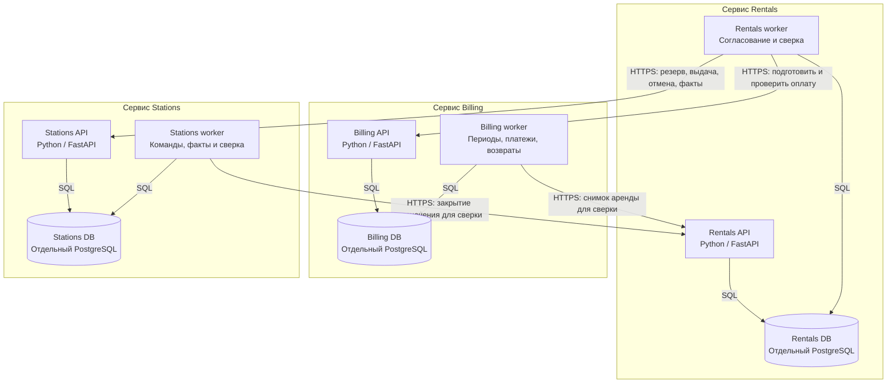

# 2. C4: уровень Container

Диаграмма показывает приложения трёх сервисов, их хранилища и внутренние HTTP-связи.

## Изоляция хранилищ

Для выбранной изоляции нужны три независимых экземпляра PostgreSQL, а не три схемы одного экземпляра. Общий сервер, диск или сеть всё равно могут стать общей причиной отказа; распределение инфраструктуры зависит от требуемого уровня отказоустойчивости во второй части. Отдельные БД сами по себе не защищают от потери всех копий данных.

API и worker одного сервиса используют одну его БД; это два контейнера одного бизнес-сервиса. Worker выбирает сохранённые задания из локальной БД, используя lease и сравнение версии. Истечение lease не разрешает повторить физический эффект под новым ключом. Сеть не входит в SQL-транзакцию.
