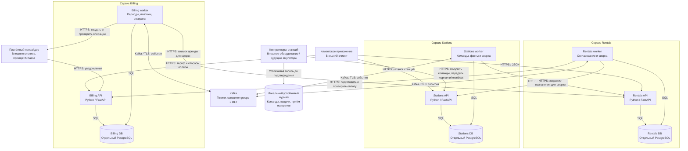

# 2. C4: уровень Container

Mermaid показывает контейнеры C4: исполняемые приложения, хранилища и внешние системы. Рамки обозначают владение сервисами. Это проект будущего стенда; работающих приложений и Docker Compose в первой части нет.

## Изоляция и источники истины

Для выбранной изоляции нужны три независимых экземпляра PostgreSQL, а не три схемы одного экземпляра. Общий сервер, диск или сеть всё равно могут стать общей причиной отказа; распределение инфраструктуры зависит от требуемого уровня отказоустойчивости во второй части. Отдельные БД сами по себе не защищают от потери всех копий данных.

API и worker одного сервиса используют одну его БД; это два контейнера одного бизнес-сервиса. Worker выбирает сохранённые задания из локальной БД, используя lease и сравнение версии. Истечение lease не разрешает повторить физический эффект под новым ключом. Сеть не входит в SQL-транзакцию.

Источники истины: Rentals — жизненный цикл аренды; Billing — начисления и соответствие операциям провайдера; Stations — назначения и принятые аппаратные факты; провайдер — действительный результат банковской операции; контроллер — устойчивый результат физической выдачи/приёма. Kafka не хранит первичный остаток устройств или финансовый результат.

## Протоколы и транспорт

- HTTP-команды начала процесса идут из Rentals в Billing и Stations. Долгие операции возвращают сохранённый ресурс, а не обещание уже состоявшегося действия.
- Каждый тип события публикуется в отдельный топик Kafka. У сервисов независимые consumer groups: `rentals.events.v1`, `billing.events.v1`, `stations.events.v1`. Экземпляры одного сервиса делят партиции внутри своей группы. Подписки перечислены в [AsyncAPI сервисов](03-contracts/asyncapi/).
- Издатели используют outbox, `acks=all` и `enable.idempotence=true`. Потребитель отключает автоматический commit offsets и фиксирует offset только после транзакции inbox и локального эффекта/постановки сверки. Нельзя зафиксировать offset дальше ещё не обработанной записи той же партиции.
- Для учебного стенда у топика три партиции и одна реплика; одна реплика не обеспечивает отказоустойчивость при потере диска брокера. Срок хранения — семь суток, ключ бизнес-события — `rental_id`. Порядок существует внутри партиции одного топика, не между топиками.
- Некорректные записи обработчик помещает в отдельный DLT-топик своего сервиса через устойчивый журнал ошибок и outbox. Это прикладная обработка, а не встроенная очередь брокера. Автоматический возврат денег из DLT запрещён.
- Контроллер сам обращается к Stations по HTTPS: получает неподтверждённые команды, отправляет heartbeat и пакеты накопленных фактов. Входящий сетевой доступ к станции не требуется. После устойчивого приёма Stations подтверждает конкретные `device_event_id`.
- Периодическая HTTP-сверка дополняет события: Rentals читает выдачу, возврат и расчёты; Billing читает снимок аренды; Stations читает закрытие назначения. Потеря события не является единственным способом навсегда остановить процесс.

## Поведение при отказах

| Что недоступно | Что происходит и как восстанавливаемся |
| --- | --- |
| Rentals API | Новые обращения к арендам недоступны; его работающий worker продолжает сохранённые задачи |
| Rentals worker | Прогресс хранится в Rentals DB; выдачи и возвраты приходят в Stations; после запуска выполняется сверка |
| Rentals DB / весь Rentals | Новые аренды не создаются; физические возвраты фиксируются в Stations или контроллере. Завершение в Rentals задерживается до восстановления. Billing продолжает известные расчёты и затем исправляет переплату |
| Billing API, worker, БД или весь Billing | Новые выдачи не проходят без подтверждённого первого платежа. Stations принимает возвраты, Rentals закрывает аренды и хранит outbox. Финансовые операции догоняют состояние после восстановления |
| Stations API / DB | Новые выдачи запрещены; контроллеры принимают возвраты в локальный журнал. Rentals не считает отсутствие ответа невыдачей |
| Stations worker | Уже принятые факты и задания остаются в БД; после запуска обработка продолжается |
| Kafka | Факты остаются в outbox; работают HTTP-сверки. Доставка после восстановления может повториться |
| Платёжный провайдер | Новая выдача ожидает достоверной оплаты или отменяется безопасно; продления могут оставаться `UNKNOWN`. Возврат устройства доступен; новые финансовые попытки не создаются поверх неизвестной |
| Связь с контроллером | Приём возврата работает локально; выдача без свежего разрешения не запускается. Накопленный журнал повторяется после связи |
| Контроллер перезапущен | Восстанавливаются журнал, поколения команд и факты. Если сам физический результат невозможно установить, состояние требует разбирательства, а не повторной выдачи |

Гарантия восстановления предполагает сохранность устойчивых журналов, БД и восстановление связи. Повреждение или уничтожение всех копий требует резервного копирования, отдельного восстановления и при необходимости оператора. Бесконечная доступность и мгновенная согласованность не обещаются.

## Наблюдаемость

Структурированные журналы содержат `rental_id`, `operation_id`, `charge_id`, `attempt_id`, `event_id`, шаг, результат и длительность; токены и реквизиты карты не журналируются. Метрики: возраст неизвестных выдач/платежей, задержка возвратов, размер outbox, consumer lag и количество записей DLT, задолженность, ожидаемые возвраты денег. Состояние `REQUIRES_REVIEW` сразу требует внимания оператора; остальные незавершённые операции — после 15 минут без прогресса. Оператор запускает сверку или повтор, но не редактирует итог вручную.

Нотация: [C4 Container](https://c4model.com/diagrams/container). Причины выбора — [ADR-001](05-decisions/0001-service-boundaries.md), протокол оборудования — [ADR-005](05-decisions/0005-offline-returns.md).
