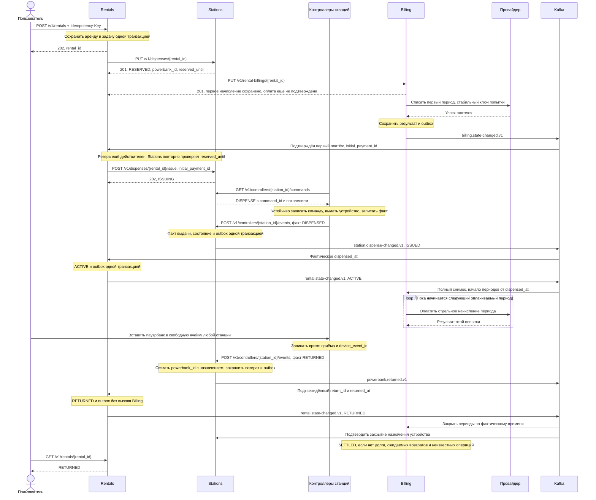
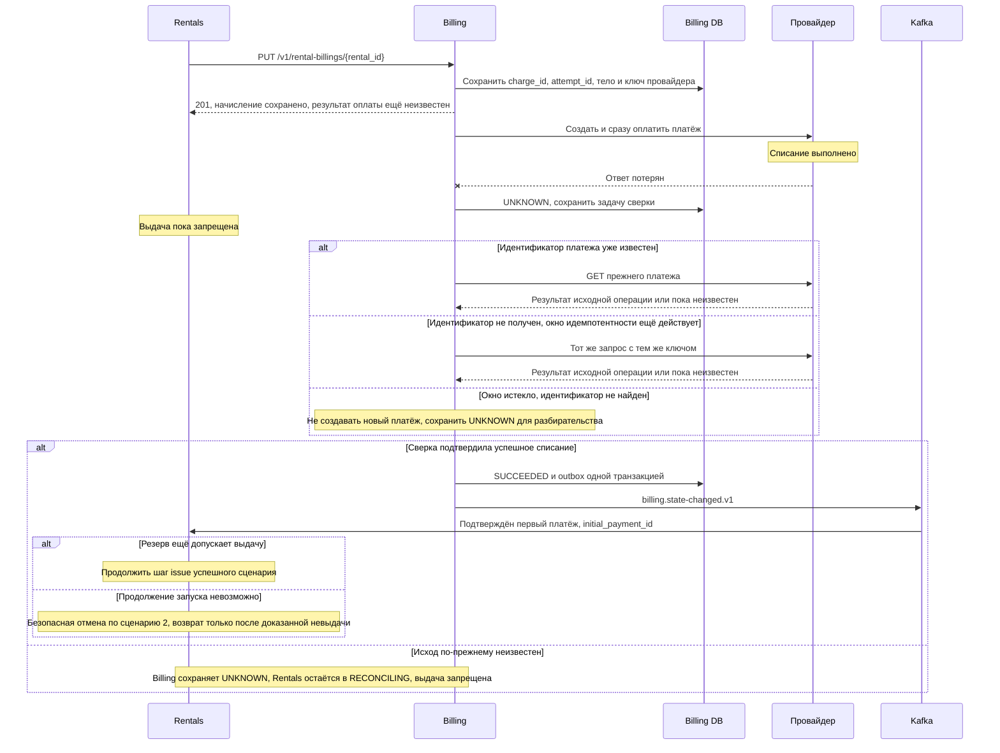
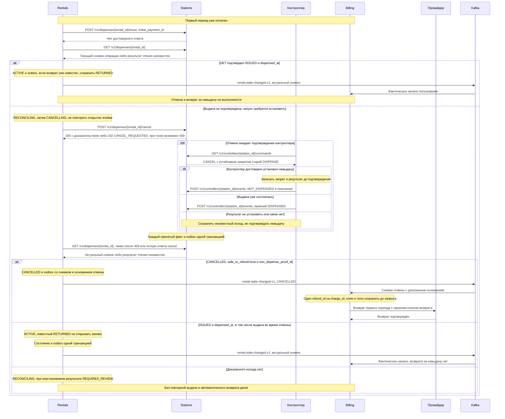
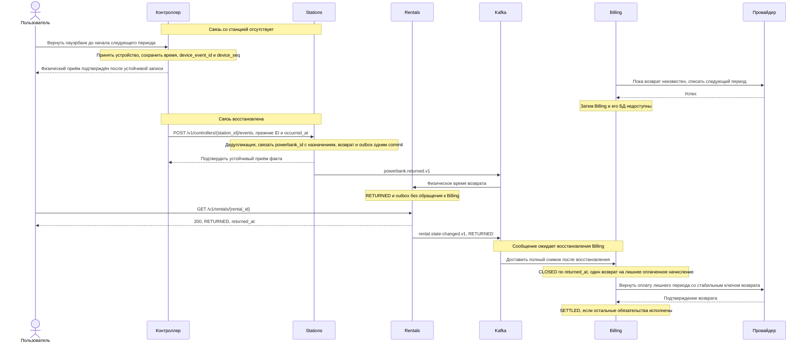

# 4. Главный процесс: взять и вернуть пауэрбанк

## Состояние и источники результата

Rentals хранит прогресс шагов и их бизнес-ключи до сетевого вызова. Его worker работает через lease и сравнение версии; два worker не могут независимо назначить противоположные переходы одной аренде. При перезапуске сначала сверяются сохранённые операции, а не создаются новые.

Физическое состояние выдачи принадлежит Stations и журналу контроллера; результат платежа — Billing и платёжному провайдеру. `202` означает сохранённое намерение. Таймаут, `5xx` или обрыв соединения означают неизвестный результат. `404` не запрещает команду, уже находящуюся в сети.

Аренда проходит `PENDING → RESERVING → PAYING → DISPENSING → ACTIVE → RETURNED`. Неизвестный шаг приводит к `RECONCILING`, безопасная отмена — через `CANCELLING` к `CANCELLED`. Неустранимое противоречие — `REQUIRES_REVIEW`. Денежный статус не включён в эту цепочку: возврат не ждёт финансового расчёта.

Событийные стрелки ниже показывают логическую передачу фактов, а не HTTP-ответы. Каждый издатель сохраняет изменение и outbox одной транзакцией своей БД; отдельный публикатор повторяет отправку с прежним `event_id` до подтверждения Kafka. Сервисы-получатели читают события из Kafka; inbox и локальный эффект/задача сверки фиксируются одной транзакцией, затем фиксируется offset. Доступа к чужим БД нет.

Восстановление до конечного результата предполагает сохранность журналов и возобновление доступности участников. При бесконечной недоступности или неустановимом внешнем результате автоматическое завершение не гарантируется.

## Успешный сценарий

Публичная сумма не принимается из запроса пользователя. Billing фиксирует согласованную версию тарифа и проверяет принадлежность способа оплаты. Известная задолженность или неразрешённые прежние расчёты блокируют новый запуск. Выдача разрешается только после подтверждённого первого списания; если резерв к тому времени истёк, выполняется безопасная отмена и возврат.

Первые 120 секунд резервирования — ограничение ресурса Stations, а не удержание денег. Команда `DISPENSE` допускает начало выдачи не позже минимума из `reserved_until` и 10 секунд после создания команды; требуется онлайн-разрешение (ADR-005). После возможной отправки команды выдачи автоматическое истечение не является доказательством отсутствия физического действия. Время первого оплаченного периода начинается только с `dispensed_at`.

## Сбой 1. Деньги списаны, ответ потерян

**Что сохранено:** начисление, попытка, точное тело запроса, ключ и время первой отправки. **Восстановление:** прежняя операция проверяется через `GET`, повтор исходного запроса в допустимом окне либо проверенное уведомление. **Компенсация:** если резерв уже нельзя использовать, сначала Stations запрещает позднюю выдачу, затем Billing возвращает первое списание. **Решение (конец):** один подтверждённый платёж и продолжение выдачи либо доказанная невыдача с одним финансовым возвратом.

Если 24-часовое окно провайдера истекло и идентификатор/результат не найден, новая операция не создаётся вслепую. Состояние требует разбирательства. Ни ожидание оператора, ни исчерпание повторов не превращают `UNKNOWN` в `DECLINED`.

Если событие Billing задержалось, Rentals выполняет `GET /v1/rental-billings/{rental_id}` и при необходимости `GET /v1/rental-billings/{rental_id}/charges`, сверяя исходное начисление и попытку. Наличие идентификатора само по себе не заменяет подтверждение успеха. Пока платёж неизвестен, Rentals может начать безопасную отмену резерва по сценарию 2; Billing продолжает сверять исходный платёж и компенсирует его поздний успех только при доказанной невыдаче.

## Сбой 2. Оплата есть, выдача не подтверждена

**Что сохранено:** назначение устройства, команда, её поколение, статус и физические факты. **Восстановление:** Rentals читает прежнюю операцию, Stations сверяется с устойчивым журналом контроллера. **Компенсация:** только доказанная невыдача разрешает возврат денег. Само серверное `CANCEL_REQUESTED`, `404`, истечение резерва или долгое отсутствие связи не подходят. **Решение (конец):** либо запрещённая поздняя выдача и один возврат, либо подтверждённая выдача и продолжающаяся аренда. Если устройство успели вернуть, сохраняется `RETURNED`, а поздняя информация только дополняет время начала.

Отправленный `CANCEL` не отменяет уже физически выполненный `DISPENSE`. Если журнал и датчики не позволяют отличить исходы, сохраняется `REQUIRES_REVIEW`; система не выдаёт ещё один пауэрбанк и не назначает необоснованный возврат денег.

`200` отмены означает уже доказанную невыдачу; `202` — только сохранённый запрос, после которого нужна сверка. `409` при гонке с выдачей, `404`, таймаут или `5xx` требуют чтения прежней операции и не разрешают компенсацию. Позднее резервирование сериализуется с отменой в Stations, а контроллер сохраняет запрет старой команды. Событие `station.dispense-changed.v1` может заменить очередное чтение результата; HTTP-ответ не изображает последующий аппаратный факт. Если ответ провайдера на возврат денег потерян, Billing сверяет прежний `refund_id` и операцию провайдера, сохраняя неизвестный результат, без второго независимого возврата.

## Сбой 3. Офлайн-возврат и лишний период

**Что сохранено:** локальный журнал возврата, входящий аппаратный факт Stations, закрытая аренда Rentals и собственные финансовые записи Billing. **Восстановление:** контроллер повторяет событие до серверного commit, затем outbox/inbox и HTTP-сверки доставляют факт заинтересованным сервисам. **Компенсация:** лишний неоплаченный период становится `VOID`; лишний оплаченный возвращается на исходную карту. **Решение (конец):** аренда `RETURNED`, начисления соответствуют фактическим временам, каждый лишний успешный платёж имеет ровно один подтверждённый возврат.

Если лишний платёж ещё неизвестен, Billing не забывает его после закрытия аренды. Поздний успех требует возврата, подтверждённый отказ — только отмены начисления. Повторные события не возобновляют тарификацию. Остановка Rentals задержала бы центральное закрытие, но не уничтожила бы локальный факт приёма.

В пакете контроллера фактическое время передаётся как `occurred_at`; Stations сохраняет его как `returned_at` в `ReturnFact` и `powerbank.returned.v1`, вместе с прежним `device_event_id`. Контроллер повторяет факты до подтверждения конкретных ID после commit Stations; доступность Kafka, Rentals и Billing для этого подтверждения не нужна. Повтор исходного события дедуплицируется, запоздавший независимый факт возврата не отбрасывается по версии выдачи. Billing сверяет версию снимка Rentals и не применяет старое ACTIVE поверх известного закрытия; возвраты денег уникальны по `charge_id`. При утрате ответа о возврате денег сверяется прежняя операция. Stations получает закрытие назначения через `rental.state-changed.v1` или HTTP-сверку с Rentals; повторная выдача устройства ждёт также заряда не ниже 80%.

## Расчёт на границе периода

При тарифе 100 ₽ / 60 минут и выдаче в 10:00 UTC:

| Возврат | Положенные периоды | Итог |
| --- | --- | --- |
| 10:20 | 1 | 100 ₽; остаток периода не возвращается |
| 11:00 ровно | 1 | 100 ₽; списанный второй период возвращается |
| 11:00:00.001 | 2 | 200 ₽; дробные секунды нельзя округлять вниз |
| 11:40 | 2 | 200 ₽ |
| 10:50, сообщение пришло в 12:10 | 1 | Периоды с началом в 11:00 и 12:00 отменяются/возвращаются |

Первый период оплачивается за факт выдачи даже при немедленном возврате. При доказанной невыдаче первого периода пользования нет и возвращается весь первый платёж.

Для подтверждённой выдачи и непротиворечивых времён применяется формула ADR-003: `max(1, ceil((returned_at - dispensed_at) / period_seconds))`. Используется UTC с дробными секундами без округления длительности вниз. Время доставки события не участвует в формуле. Лишние неоплаченные обязательства отменяются, оплаченные компенсируются, неизвестные платежи остаются на сверке. Если время начала ещё не установлено или часы противоречат фактам, финансовый расчёт ждёт сверки, а физический возврат сохраняется.

## Дополнительные отказы

| Ситуация | Допустимое поведение |
| --- | --- |
| Платёж первого периода подтверждённо отклонён | Безопасно снять резерв; не выдавать устройство; не создавать долг за несостоявшуюся аренду |
| Продление отклонено | Создать долг за этот период; до трёх автоматических попыток: в срок, через одну и пять минут от срока, только после подтверждённого отказа; UNKNOWN блокирует новую попытку, пропущенные слоты не догоняются пачкой; возврат остаётся доступен |
| Worker умер после успешного внешнего эффекта | Проверить прежний ключ и состояние; не создавать новую попытку или команду |
| Повторный запрос создания с другим ключом | Уникальное ограничение незавершённой аренды запрещает вторую аренду |
| Два запроса на последний пауэрбанк | Stations транзакционно выбирает и назначает его только одному запросу |
| Брокер недоступен | Outbox сохраняет события; HTTP-сверки читают выдачу, возврат и расчёты |
| Уведомление провайдера продублировано или поддельно | Inbox и проверка объекта у провайдера не допускают второго денежного эффекта |
| Возврат пришёл раньше сообщения о выдаче | Сохранить факт возврата; поздняя выдача дополняет начало, не отменяет конец; устройство не переиздавать до сверки |
| Устройство вернули, но старое назначение ещё не закрыто | Принять физически, сохранить факт; не выдавать его повторно до подтверждения Rentals и зарядки |
| Отмена и выдача пришли в другом порядке | Устойчивое поколение/запрет контроллера не даёт поздней команде оживить отменённую выдачу |
| Часы контроллера противоречат фактам | Сохранить исходные данные, запретить новые выдачи при проблеме часов, передать расчёт оператору для сверки |
